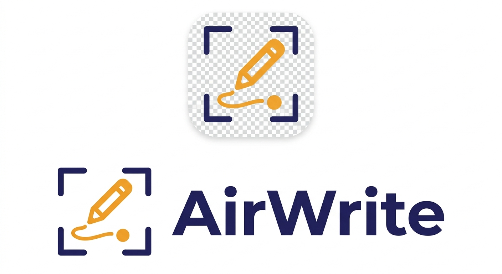

# AirWrite



Write on a blank sheet of paper with your finger and get a real PDF.

An **overhead camera** tracks your index fingertip and maps it through a configurable
four-corner box onto a virtual page. A **side camera** watches the fingertip's height above
the desk to decide when the pen is down. Strokes are kept as vectors in page millimetres,
so the export is a true vector PDF rather than a screenshot.

Next.js 16 (App Router) · TypeScript · Tailwind v4 · MediaPipe Tasks-Vision · jsPDF.
Everything runs in the browser — no server, no uploads.

## Run

```sh
npm install     # postinstall vendors the MediaPipe wasm + hand model into public/
npm run dev     # http://localhost:3000
```

This local replica uses Webpack for development and production builds to avoid a
Turbopack child-process failure on Windows. The application source and design are
from upstream commit `724f658`. Run `npm run build` followed by `npm start` for
production mode. The initial build needs internet access for Google Fonts.

Typed-text export needs a key; everything else works without one:

```sh
cp .env.local.example .env.local   # then put your ANTHROPIC_API_KEY in it
```

`getUserMedia` needs a secure context — `localhost` qualifies. To reach it from another
device on your network, put it behind HTTPS.

Then: **Start cameras** → pick the overhead and side devices → **Fit box to paper** → drag
the four corners onto the paper's corners → rest your fingertip on the page and hit **Set
desk line from finger** → write → **Export PDF**.

## Two ways to export

**Your handwriting** — the strokes exactly as drawn, written straight to PDF as vector
paths. No network, no key; nothing leaves the browser.

**Typed text** — each inked page is rendered to a clean PNG and sent to Claude
(`claude-opus-5`, vision) through `/api/transcribe`, which reads the handwriting back as
text. The transcription lands in an editable box in the export dialog so you can fix what
it misread, then it's typeset into the PDF as **real, selectable, searchable text** in
Times, Helvetica, or Courier at a size you pick. Text that overruns a sheet flows onto
continuation pages.

The transcription prompt is deliberately conservative: it preserves your spelling and line
breaks, doesn't rephrase or complete your sentences, and writes `[?]` where a word is
genuinely illegible rather than inventing one.

Matching *your* handwriting as a font isn't supported — the typed option gives you standard
PDF faces.

## Layout

```
src/
  app/            layout, page shell, Tailwind theme tokens
    api/transcribe/  server route — Claude vision handwriting transcription
  components/     TopBar, CameraStage (PaperCamera + SideCamera), PagePreview,
                  ControlPanel, ui primitives
  hooks/
    useAirNotebook.ts   cameras, trackers, the rAF loop, pen state, persistence
  lib/
    geometry.ts   homography solve/apply, clamp, point-in-quad
    filter.ts     One Euro filter
    tracker.ts    MediaPipe HandLandmarker wrapper
    cameras.ts    device enumeration + getUserMedia
    notebook.ts   pages, strokes, two-layer canvas rendering
    overlay.ts    all overlay drawing (box, desk line, hand, fingertip)
    pdf.ts        vector (handwriting) + typeset (transcribed) export
    transcribe.ts page → PNG → /api/transcribe
    library.ts    saved docs + sections in localStorage
scripts/
  setup-mediapipe.mjs   vendors wasm from node_modules, downloads the model
legacy/            the original vanilla-JS version this was ported from
```

## Docs

**Save to docs** names the current notebook and files it under a section — one per class or
project. `/docs` lists them: sections in the left sidebar, cards with a page thumbnail on the
right, and per doc: reopen in the notebook, rename, move between sections, or re-export the
vector PDF. Everything lives in `localStorage`, so docs are per-browser.

## Brand

`src/app/icon.svg` and `src/app/apple-icon.png` are the app icons; `src/components/Logo.tsx`
draws the mark inline (navy `#232559` frame, amber `#F0A22F` pencil). The original lockup is
at `public/brand/airwrite-lockup.jpg`.

## How it works

**Paper box → page.** The four draggable corners plus the page rectangle give eight
equations; `solveHomography` solves the projective transform by Gaussian elimination. That
makes the mapping correct even when the overhead camera looks at the desk at an angle — an
affine fit would bow the writing. Corners persist in `localStorage`.

**Pen up/down.** `lift = deskY − fingertipY` in the side view. Down below `downT`, back up
only above `upT`. The gap between the two is hysteresis, so a finger resting near the
threshold doesn't chatter the pen on and off.

**Jitter.** A One Euro filter, whose cutoff scales with speed: still while you hover, quick
during a fast stroke. It's reset at each stroke start so there's no lead-in smear from the
previous position.

**Rendering.** The page canvas is two layers — a cached `base` holding paper plus committed
strokes, and the in-progress stroke drawn on top each frame. Cost stays flat as the page
fills. React state updates are throttled to ~8 Hz; the canvases run at frame rate, driven
entirely from refs.

### Pen triggers

| Mode | How | When |
|---|---|---|
| **Height** | side-camera fingertip height | the real thing; needs the second camera |
| **Pinch** | thumb-to-index, normalized by palm width so depth doesn't matter | one-camera fallback |
| **Space** | hold the space bar | checking the box fit without trigger logic |
| **Always** | ink whenever a hand is tracked in the box | calibration |

## Tuning

- Mount the side camera **at roughly desk level, looking across the paper**. Angled down
  from above, hovering and touching are a pixel or two apart and no threshold will separate
  them.
- **Margin crop** shrinks the target rectangle inside the page, so writing that runs to the
  edge of the paper still lands inside the PDF margins.
- **Smoothing** drives the One Euro `minCutoff`/`beta`; ~0.5 suits normal handwriting, lower
  it if letters feel laggy.
- If tracking drops, ink lifts after 4 lost frames rather than drawing a line across the page.

## Limits

- One hand, index fingertip only. A bare finger tracks better than a held pen — the model is
  looking for the finger.
- The notebook itself isn't persisted; export before closing the tab.
- Transcription quality tracks handwriting quality. Finger-written text is shakier than pen
  on paper, so expect to touch up the transcription before exporting.
- If `npm install` couldn't download the model, the tracker falls back to the Google CDN at
  runtime. Re-run `npm run setup:mediapipe` to vendor it locally.
